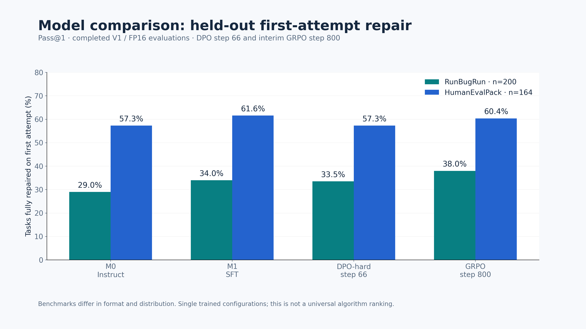

# RepairRL

**LLM post-training in practice:** specialize a small code model to repair Python programs, then compare learning from demonstrations, preferences, and execution rewards.

[Technical report](docs/seminar/TECHNICAL_REPORT.md) · [Live demo](docs/seminar/DEMO_QUICKSTART.md) · [Slide figures](docs/seminar/figures/README.md) · [60-minute talk outline](docs/seminar/07_TALK_60_MIN.md)

## The experiment

Starting from **Qwen2.5-Coder-1.5B-Instruct (M0)**:

```text
M0 ── repair SFT ──► M1 ──┬── verified repair preferences ──► DPO
                          └── rewards from executing tests ─► GRPO
```

DPO and GRPO independently start from M1. A separate untouched pretrained model is also evaluated. At inference, the V1 agent can regenerate code using sanitized test feedback, with at most three attempts.

- **Training:** 2,000 verified RunBugRun Python pairs.
- **Evaluation:** 200 problem-disjoint RunBugRun examples and 164 HumanEvalPack tasks.
- **Scope:** full replacement Python programs/functions, not repository-level repair.

## Completed results

Matched **FP16 / V1** evaluations, 768 generated tokens per attempt. Each cell is **pass@1 / agent@3**.

| Model | RunBugRun · 200 | HumanEvalPack · 164 |
|---|---:|---:|
| Pretrained Coder | 27.0% / 28.5% | 11.6% / 11.6% |
| M0 Instruct | 29.0% / 30.0% | 57.3% / 64.6% |
| M1 SFT | 34.0% / 40.0% | **61.6% / 65.9%** |
| DPO-hard · step 66 | 33.5% / 38.0% | 57.3% / 63.4% |
| GRPO · step 800 | **38.0% / 42.5%** | 60.4% / **65.9%** |

GRPO step 800 is an **interim checkpoint selected on dev**. Later checkpoints are separate experiments. These results show an in-domain GRPO gain and no demonstrated transfer gain on HumanEvalPack. This DPO configuration underperformed SFT; the experiment does not establish that DPO generally harms coding ability.



[Measured aggregates and provenance](docs/seminar/report/results.json) · [Paired uncertainty estimates](docs/seminar/report/paired-comparisons.json)

## Run the live demo

The demo has six prefilled problems, rendered descriptions and math, an editable Python editor, five model choices, a highlighted change view, live test verdicts, and optional feedback retries. Selected success/failure cases are disclosed as curated demonstrations.

On the Linux GPU machine, **after restoring the required data and model artifacts**:

```bash
uv sync --frozen --extra dev
uv run python demo_app.py --port 7860
```

On another computer with SSH access to that GPU machine:

```bash
ssh -N -L 7860:127.0.0.1:7860 USER@GPU_HOST
```

Open **http://localhost:7860**. The application binds to loopback. Inference and tests run on the GPU machine.

The source repository does not include prepared datasets or trained adapters. See the [demo guide](docs/seminar/DEMO_QUICKSTART.md) for exact artifact paths, dependencies, measured timings, and the recommended demonstration sequence.

## Reproduce the workflow

| Step | Main implementation |
|---|---|
| Acquire and prepare data | `data/`, `scripts/fetch_runbugrun.py` |
| Train repair SFT | `training/train_sft.py`, `configs/full-sft.yaml` |
| Generate verified negatives | `scripts/round2_fast_rollouts.py`, `scripts/round2_rollouts.py` |
| Train DPO / GRPO | `scripts/round2_train.py` |
| Execute and score programs | `evaluation/runner.py`, `evaluation/humanevalpack_adapter.py` |
| Evaluate checkpoints | `evaluation/round2.py` |
| Generate report figures | `scripts/build_seminar_figures.py` |

Start with [data preparation](data/README.md), the [evaluation protocol](EVAL_PROTOCOL.md), and the [technical report](docs/seminar/TECHNICAL_REPORT.md). [Exact split membership](data/manifests/runbugrun-splits.json) contains IDs and hashes without redistributing programs or hidden tests.

The original environment uses Python 3.11/3.12 for training, CUDA-compatible Torch, TRL, Transformers and PEFT pinned in the lockfiles. Generated programs were evaluated using Python 3.14.4. The local runner requires Linux Bubblewrap; the optional server runner is described in [execution notes](docs/seminar/SERVER_GRADER_MIGRATION.md).

```bash
uv run python -m pytest -q
```

[Data/model artifacts](docs/ARTIFACTS.md), training states and raw traces are intentionally outside Git. Full Trainer checkpoints support continuation; inference adapters alone do not restore optimizer/scheduler/RNG state.

## Seminar material

- [Full implementation and findings](docs/seminar/TECHNICAL_REPORT.md)
- [Three measured case studies](docs/seminar/TECHNICAL_REPORT.md#9-three-curated-case-studies)
- [Eight PNG/SVG figures and PDF](docs/seminar/figures/README.md)
- [ReCode connection](docs/seminar/06_RECODE_CONNECTION.md)

RepairRL implements execution **outcome rewards**. It does not reproduce ReCode's learned process-reward model or complete consistency-gated method.

Source data and models retain their respective upstream terms. Curated examples, public benchmark contamination, limited test suites, single-seed training and interim evaluation are discussed in the report.
