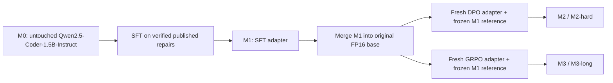

# 01 — Context, motivation and architecture

## The practical question

Can a small instruction-tuned code model improve at **executable Python repair**
through SFT, preference optimization or reinforcement learning? Separately, does
test-guided inference recover additional failures? RepairRL makes those questions
observable through independently saved checkpoints and an external grader.

The project is a useful seminar case because its difficult parts are concrete:
constructing trustworthy examples, fitting adapters in consumer GPU memory,
maintaining the correct reference policy, extracting useful rewards, managing
untrusted execution, and distinguishing a completed training job from learning.

## What a task looks like

The model receives a problem specification and a buggy Python program. It returns
one complete replacement program. RunBugRun tasks read stdin and write stdout;
HumanEvalPack tasks require function definitions and use a separate adapter.

The output is not a unified diff. This reduces ambiguity in parsing and execution
for small standalone programs. The scope excludes repository navigation,
multi-file patches, package installation by the candidate, issue triage and SWE-bench.

Inputs to the model never include the published fixed solution or scoring-only
test source/expected output. Public examples naturally present in a problem
statement are distinct from private scoring feedback.

## Two independent axes of change

### Axis 1: post-training changes model weights

M2 and M3 are siblings. Neither starts from the other. An untouched M0 is required
to measure SFT's effect, while M1 is the direct comparator for DPO/GRPO.

LoRA adapters modify selected attention and MLP projections. The original run
used NF4 QLoRA. In round 2, remote rollout inference and the active GRPO branch use
FP16 base weights with LoRA, because the model fits and quantized generation had
unfavorable throughput. This is a changed deployment/training setting, not proof
of an algorithmic gain.

### Axis 2: the inference controller changes behavior without training

V1 sends compact test summaries back into the next repair prompt. V3 adds bounded
diagnosis calls and keeps the best tested candidate. V3.1 makes the plan explicit,
preserves it during prompt compaction, records actual edits, and feeds failed edit
outcomes into the next diagnosis. These are inference-time calls; they do not
update weights or turn the SFT dataset into multi-turn trajectories.

Changing both model and controller at once confounds attribution. The new dev
ablation fixes M1 and compares V1, V3.1 without diagnosis, and V3.1. The new
evaluation plan reports the selected models under the same controllers rather
than comparing a new agent against an old-model/old-controller score.

## Component map

| Component | Main implementation | Responsibility |
|---|---|---|
| Prompt/provenance | [`repairrl/common.py`](../../repairrl/common.py) | Frozen repair template, config inheritance, hashes, JSONL |
| Model loading | [`repairrl/model.py`](../../repairrl/model.py) | Pinned Qwen, NF4/FP16 loading, generation budgets |
| Published data | [`data/`](../../data/) | SQL extraction, context filtering, verified grouped splits |
| Shared trainers | [`training/common.py`](../../training/common.py) | Data contracts, LoRA, formatting, optimization metadata |
| Original arms | [`training/`](../../training/) | SFT, weak DPO, outcome-reward GRPO |
| Second round | [`scripts/round2_train.py`](../../scripts/round2_train.py) | Hard-data validation, intermediate adapters and dev selection |
| Agent | [`agent/`](../../agent/) | V1, V2, V3 and V3.1 controllers |
| Grading | [`evaluation/runner.py`](../../evaluation/runner.py) | Program parsing and benchmark output comparison |
| Isolation | [`agent/sandbox.py`](../../agent/sandbox.py) | Bounded Bubblewrap candidate process |
| Remote grading | [`evaluation/grading_service.py`](../../evaluation/grading_service.py) | Private RPC to the same local grader |
| External benchmark | [`evaluation/humanevalpack_adapter.py`](../../evaluation/humanevalpack_adapter.py) | Function-call bridge, hidden assertions outside candidate |
| Demo UI | [`app.py`](../../app.py) | Original local V1 interface; not an automatic V3.1 UI |

The original Gradio app is not evidence that new controllers or second-round
adapters have been integrated into its UI. Inspect available adapters and CLI
arguments before demonstrating it.

## Original and current machines

| Work | Original setup | Current setup |
|---|---|---|
| Original four-arm experiment | Local RTX 3060, 12 GB | Completed, preserved |
| Hard-negative bank/DPO queue | — | Remote RTX 5070 GPU 0, approximately 12 GB |
| Longer GRPO/follow-up queue | — | Remote RTX 5070 GPU 1, approximately 12 GB |
| Controller dev ablation | Five-problem smoke check | Local RTX 3060, 40 distinct dev problems |
| Trusted candidate execution | Local Bubblewrap | Same local grader, privately forwarded to remote jobs |

The two remote GPUs are independent single-GPU workers. There is no DDP, shared
24 GB address space, or claim of a two-GPU training speedup. Their advantage is
parallel experiment throughput. Their Vast container storage is ephemeral.

## Narrative for the seminar

1. A runnable post-training stack requires trustworthy data and a grader before a trainer.
2. SFT makes output behavior easier to learn but low loss need not imply repair success.
3. DPO learns the preferences it is given; weak negatives can solve the wrong distinction.
4. GRPO needs informative variation in execution rewards, not just more updates.
5. A debugging loop needs preserved hypotheses, explicit changes and measured outcomes.
6. Reproducibility includes model lineage, runtime semantics, failed jobs and resumable state.

The defensible outcome is an instrumented practical experiment with mixed initial
results, followed by better-targeted experiments. It is not a reproduction of
ReCode, Repair-R1, or a general software-engineering agent.
