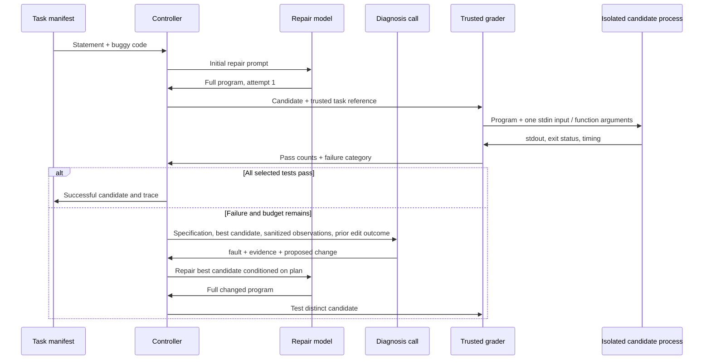
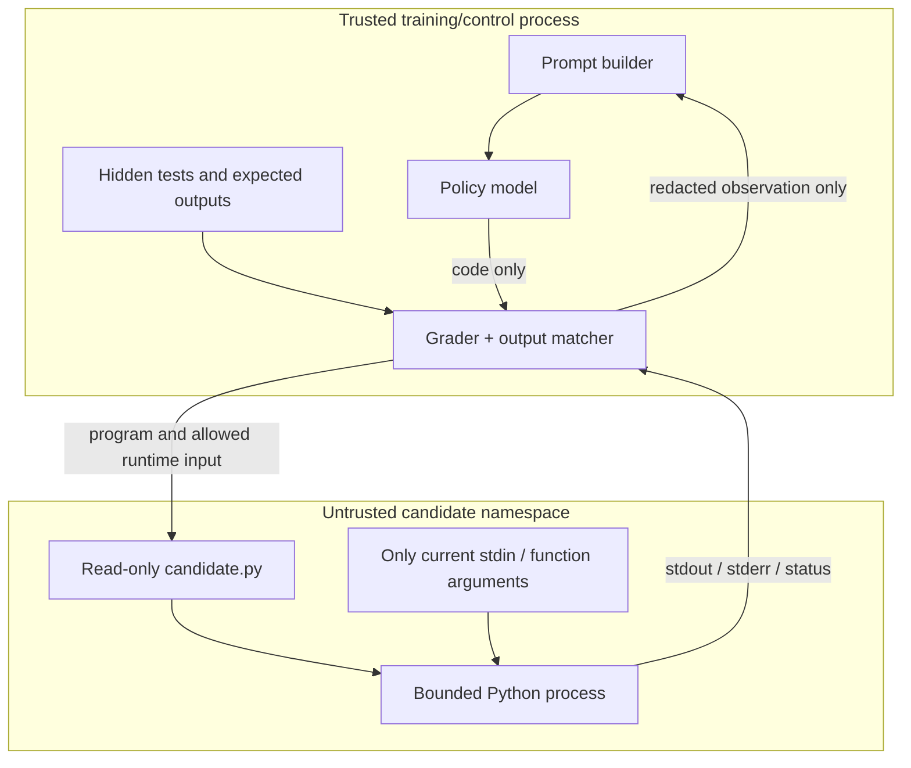

# 04 — Agent, trusted execution and evaluation

## The agent is an inference controller

The model returns full replacement programs. The controller chooses the next
prompt, calls the model, sends candidates to the grader and decides when to stop.
There are no online weight updates inside this loop.



The maximum is **three code-generation calls**, not three fresh independent
samples. V3/V3.1 permit at most two additional short diagnosis calls. Their
extra compute must be counted even when success rates do not improve.

## Controller versions

| Version | Actual behavior | Main source |
|---|---|---|
| V1 | Latest candidate + pass-count/category feedback; greedy regeneration | [`agent/repair.py`](../../agent/repair.py) |
| V2 | Redacted diagnostics/history; AST repeat detection; bounded sampled stuck retry | [`agent/repair_v2.py`](../../agent/repair_v2.py) |
| Original V3 | Up to two JSON diagnoses, best tested candidate, duplicate rejection before re-execution | [`agent/repair_v3.py`](../../agent/repair_v3.py) |
| V3.1 | Explicit proposed change, plan-preserving prompt compaction, measured edit/outcome history, fixed retry exploration | [`agent/repair_v31.py`](../../agent/repair_v31.py) |

Original V3 defaults to 96 diagnosis tokens. V3.1 uses 128, with three-field JSON:

```json
{"fault":"a code-level hypothesis","evidence":"observed fact or specification constraint","change":"concrete replacement behavior"}
```

`parse_diagnosis` rejects missing/extra fields, empty values and oversized fields.
There are no unbounded attempts to repair malformed JSON. A diagnosis is a
hypothesis, not a correctness certificate or a trained process reward.

V3.1 records the actual code diff and whether it improves the best tested score.
The next diagnosis receives the prior proposed change and measured failure,
even when a regressed candidate is discarded. `planned_prompt` removes history
before dropping a plan; if the irreducible prompt is too large, generation records
an explicit context overflow instead of silently abandoning the plan.

Code fingerprints use ASTs to ignore formatting/comments. A repeated patch
consumes a code-generation attempt and is rejected before another execution. This
saves redundant tests; it cannot guarantee that the language model never produces
a duplicate. The old five-task check still generated repeats after rejection.

Best-candidate ranking prioritizes success, then test fraction and validity; V3.1
also uses fatal execution failures as a tie-break. A higher partial score is only
a diagnostic improvement on the selected suite, not general correctness.

The `plan_in_repair_prompt` trace flag currently uses a textual membership test;
quoting/representation can affect that flag. The prompt-construction code and
raw stored prompt/plan are the authoritative evidence of plan retention. No
semantic verifier proves that a program implements its proposed change.

## Feedback without hidden values

[`Grade.feedback`](../../evaluation/runner.py) exposes only count and category,
for example `3/10 tests passed. Result: incorrect_output.` The diagnostic helper
allowlists exception types and candidate line numbers; it drops exception
messages, raw stderr, stdout, paths and private values.

Do not feed `grade.tests` verbatim into the model. Candidate-controlled stderr
can itself contain instructions or echoed input values. The tests explicitly
check that private marker strings do not appear in diagnosis/repair prompts.

## Trust boundaries



[`agent/sandbox.py`](../../agent/sandbox.py) uses Bubblewrap with isolated
namespaces, no network, UID/GID 65534, dropped capabilities, a read-only `/usr`
and candidate mount, temporary writable storage and resource limits. Standard
limits are 3 seconds wall/CPU per test, 512 MB address space, one process, bounded
file descriptors/file size and 64 KiB captured output. The grader and test files
are never mounted in the candidate namespace.

Training Python was 3.11.16; the candidate interpreter is system Python 3.14.4.
The trusted AST parser and the execution interpreter therefore differ. Gold and
model candidates use the same harness, and the gold gate detects many
incompatibilities. Reproduction should retain both interpreter versions.

The remote Vast container does not permit the required namespaces. Remote jobs
use [`GradingClient`](../../evaluation/grading_service.py) through a loopback-only
SSH reverse tunnel to the existing local Bubblewrap grader. This keeps scoring
semantics stable across machines. The local grader process and tunnel must stay
available while remote training/evaluation depends on them. No public grading
endpoint or cloud tunnel was opened.

## Two benchmark adapters

RunBugRun: parse candidate code, execute each selected stdin/stdout test, and
compare output using the ported upstream normalization/tolerance policy.
`FLOAT_EPS` is problem-specific; nonzero exit status is a failure even if some
printed output matches. Do not replace this with HumanEval assertions.

HumanEvalPack: the trusted process evaluates published assertions using a bound
candidate-call bridge. Each candidate function call is isolated and transported
using the JSON codec in [`repairrl/codec.py`](../../repairrl/codec.py). Assertions
and expected values stay outside the candidate. Individual calls have 3-second
limits and suites have an aggregate 30-second budget checked between calls.
Its suite is scored as one all-pass/fail unit; there is no claimed partial
assertion accuracy.

## Metrics and protocol changes

| Metric | Definition |
|---|---|
| First-attempt success / pass@1 | Fraction of tasks passing all tests on the first generated program |
| Agent@3 | Fraction solved within at most three sequential feedback-guided attempts |
| Extra repairs | Agent successes that failed on attempt 1 |
| Validity | Fraction of generated programs parseable by the harness |
| Partial fraction | Selected tests passed / selected tests; diagnostic only |
| Duplicate rate | Repeated generated ASTs within a task |
| Cost | Code and diagnosis tokens, generation/test time, wall time, attempts and tests |

Agent@3 is not independent-sampling pass@3. The feedback changes later prompts,
and successful tasks stop early.

Original common protocol: NF4 inference, 2,048 context, 512 generated tokens,
greedy decoding, seed 42, V1 controller, same task IDs/tests, at most three attempts.

Round 2: FP16 inference, 4,096 context, 768 code tokens, V1 and V3.1 tables, and
V3.1 retry temperature 0.4 with up to two 128-token diagnoses. The local dev
ablation also includes the no-diagnosis controller to expose the effect of retry
exploration/best-candidate tracking separately from diagnosis.

Round-2 checkpoint selection uses fixed dev problems. It is not based on test
scores. Different hardware can affect timing and floating-point decoding; include
the machine/precision in reports and avoid claiming a pure training speedup from
cross-machine latency differences. Exact M1-parent identity must also be checked.

[`evaluation.compare.py`](../../evaluation/compare.py) rejects incompatible
original protocols. The second-round reporter checks matched task IDs, data/test
hashes, budgets, controllers and generator identity, and proposes problem-clustered
bootstrap comparisons. Until those runs complete, confidence intervals are
pending, not evidence of a significant gain.
