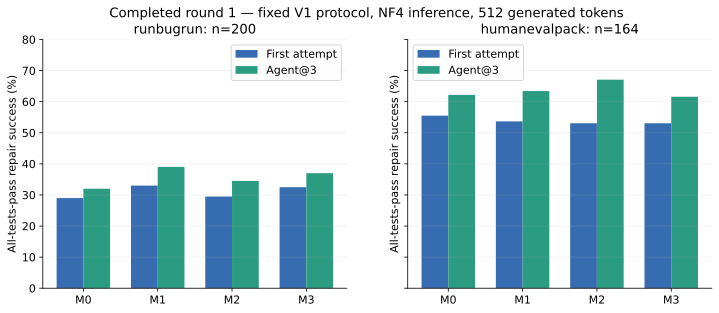
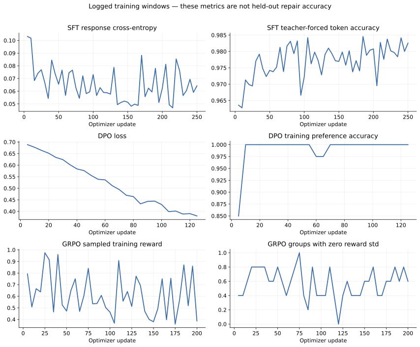
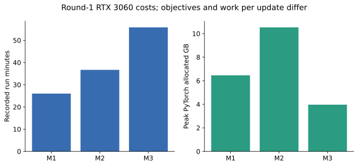

# 05 — Experiments, findings and failures

## Completed original four-arm result

These measurements use the original fixed V1 protocol: greedy NF4 inference,
2,048 context, 512 generated tokens, same tests/task IDs, up to three feedback
attempts. The RunBugRun set contains 200 pairs/144 problems; HumanEvalPack has
all 164 Python tasks. Check generated evidence for source paths and checksums.

| Checkpoint | RBR first attempt | RBR agent@3 | HEP first attempt | HEP agent@3 |
|---|---:|---:|---:|---:|
| M0 | 58/200 = 29.0% | 64/200 = 32.0% | 91/164 = 55.5% | 102/164 = 62.2% |
| M1 SFT | 66/200 = 33.0% | 78/200 = 39.0% | 88/164 = 53.7% | 104/164 = 63.4% |
| M2 weak DPO | 59/200 = 29.5% | 69/200 = 34.5% | 87/164 = 53.0% | 110/164 = 67.1% |
| M3 GRPO | 65/200 = 32.5% | 74/200 = 37.0% | 87/164 = 53.0% | 101/164 = 61.6% |

Observed takeaways:

- SFT has the best RunBugRun scores: +4 percentage points first-shot and +7
  points agent@3 versus M0.
- SFT did not improve HumanEvalPack first-shot accuracy. More successful retry
  behavior is not the same as a universally better first response.
- Weak DPO improves HumanEvalPack agent@3 over M1 by six tasks, about 3.7 points,
  but loses nine RunBugRun agent successes.
- GRPO did not beat M1 on either benchmark. Finishing 200 RL updates is not proof
  of useful learning.
- Point estimates do not establish significance. Multiple pairs share problems,
  and this is a single-seed experiment.

## Training curves and their interpretation

Data source: per-arm `repairrl-training.json::log_history`; exported numeric data
are in [round1-training-curves.json](generated/round1-training-curves.json).

| Arm | Mean train loss | First logged window | Last logged window | What it means |
|---|---:|---|---|---|
| M1 | 0.06527 | loss 0.1031, token accuracy 96.36% | loss 0.0642, token accuracy 98.25% | Gold-token fit under teacher forcing |
| M2 | 0.51926 | loss 0.6887, preference accuracy 85% | loss 0.3803, preference accuracy 100% | Training preference ranking, not execution success |
| M3 | -0.000473 | Signed policy loss fluctuates | last loss -0.0018 | Policy-gradient objective; not comparable to CE/DPO loss |

Do not put all three loss scales on one axis and rank algorithms by magnitude.
GRPO reward windows also vary with sampled task difficulty. A rising sampled
training reward is not a held-out learning curve. In round 1, no intermediate
checkpoint was selected by dev repair accuracy; final checkpoints were evaluated.

The original M3 training rollouts contained 356 all-pass programs out of 800
samples (44.5%), 346 incorrect outputs, 76 runtime errors, 21 invalid programs and
one timeout. Those are training samples, not 800 held-out cases. Only 86/200 groups
had reward variation; the remaining 57% provided no relative reward distinction.

## Cost measured on the RTX 3060

| Arm | Updates | Recorded run + save | Peak allocated VRAM |
|---|---:|---:|---:|
| M1 | 250 | 26.0 min | 6.46 GB |
| M2 | 125 | 36.7 min | 10.53 GB |
| M3 | 200 | 55.8 min | 3.97 GB |

DPO's wall time includes reference-probability computation; its optimizer loop
was 25.0 minutes. GRPO's time includes generation and execution grading. Peak
allocated memory is a PyTorch measurement, not reserved memory or total nvidia-smi
usage. The three objectives do different work per update.

Original full evaluation took approximately 64.1 minutes for M0, 99.5 for M1,
98.0 for M2 and 95.7 for M3 across both benchmarks: nearly six hours in total,
compared with about two hours of recorded main training. Evaluation was a major
wall-clock cost in this implementation.

## Completed old controller smoke check

Fixed M1, five distinct dev problems: V1, V2 and original V3 each solved 2/5 on
attempt 1 and 2/5 by attempt 3. V3 made six diagnosis calls, five parseable JSONs,
and rejected four repeated patches, but still generated four repeats. Model time
was 73.2 seconds versus 43.7 seconds for V1. This small check established bounded
execution and added cost, not a quality advantage.

## New 40-problem dev ablation

The completed local comparison uses FP16 M1, the same 40 distinct dev problems,
the new 768-token/4,096-context budget and fixed seeds. It must not be pooled with
the old five-case smoke check.

| Controller | First attempt | Agent@3 | Extra repairs | Diagnosis calls | Duplicate generations |
|---|---:|---:|---:|---:|---:|
| V1 | 13/40 | 15/40 | 2 | 0 | Not instrumented by V1 |
| V3.1 without diagnosis | 13/40 | 14/40 | 1 | 0 | 48 |
| V3.1 | 13/40 | 14/40 | 1 | 53 | 43 |

V1's exported duplicate counter defaults to zero because the V1 trace lacks that
field. Do not interpret that zero as evidence that V1 never repeats. For a
cross-controller repeat-rate comparison, recompute AST fingerprints from all raw
generations, as the original controller comparison script does.

Diagnosis did not add solves over the no-diagnosis ablation. The new controller
records and tests meaningful state transitions, but that engineering improvement
did not translate into a measured success-rate gain here. This is an important
negative finding, not a reason to select only attractive demos.

## Second-round experiments: not final results

See [LIVE_STATUS.md](generated/LIVE_STATUS.md), which is regenerated from actual
artifacts. The hard-negative bank is growing over the full train manifest; DPO
waits for its immutable completion. GRPO-long is optimizing after a 20/30
mixed-group preflight and will evaluate intermediate checkpoints on dev.

Do not present the active GRPO baseline at step 0 as a trained result. Do not
quote partial rollout yields as the final DPO dataset size. No new held-out
improvement is established until selected-checkpoint evaluation finishes.

Round 2 changes precision, code budget, sampling, reward, update budget and
checkpoint selection. Its new baseline/controller table is necessary. Even if
the new package wins, a reward-only causal claim requires a controlled ablation.

## Engineering failures and responses

| Observation | Response | What can be claimed |
|---|---|---|
| Original DPO OOM at update 6 | Expandable CUDA allocator + persistent reference cache; retry preserved separately | Successful recovery at original 2,048 context |
| Many zero-variance GRPO groups | Preflight gate, group-variance logging; new sampler/reward/longer monitored run | Variance is necessary, not sufficient for useful RL |
| V3 repeats despite rejection | AST rejection consumes budget; store best candidate and edit outcome | Avoids repeated execution, not guaranteed unique generation |
| V3 plan could be lost under old context compaction | V3.1 retains plan before history | Better interface contract; not demonstrated accuracy gain |
| Remote user namespaces unavailable | Private RPC to the same local sandbox grader | Candidates are not run directly with remote root privileges |
| NF4 rollout throughput disappointing on new hardware | FP16 inference and multi-prompt batching | Empirical throughput decision, not a universal precision rule |
| Local/remote M1 merges differ numerically | Preserve both, copy exact remote parent for common-parent evaluation | Parent identity matters beyond model names |
| Code changed after a process imported it | Archive on-disk source and recover exact executed trainer by recorded hash | Latest HEAD alone is insufficient provenance |

## Limitations to retain on slides

Small model and limited tuning; one original seed; selected 2–10-test suites;
partial-score comparability limits; imperfect statement heuristics; possible
semantic/pretraining contamination; reused benchmarks; original response-cap
mismatch; merge/requantization differences; controller cost; and uncertain
generalization beyond competitive-programming repair. Explain weak results as
observations plus hypotheses, not proven causal diagnoses.
