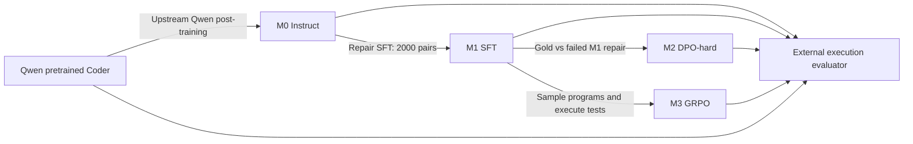
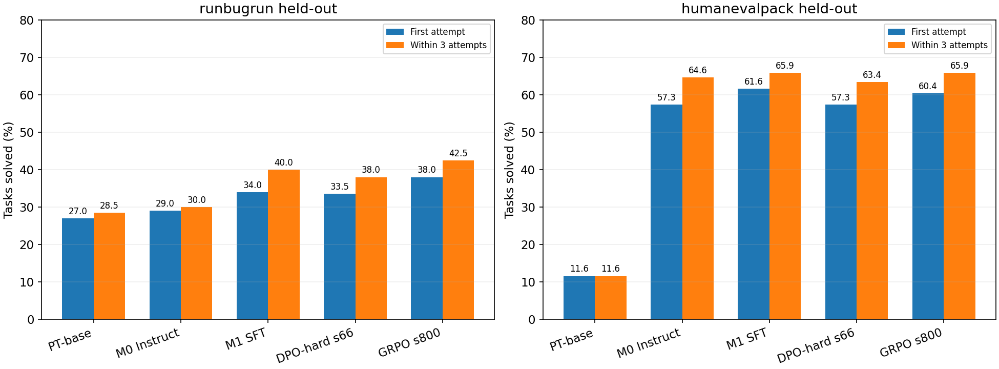
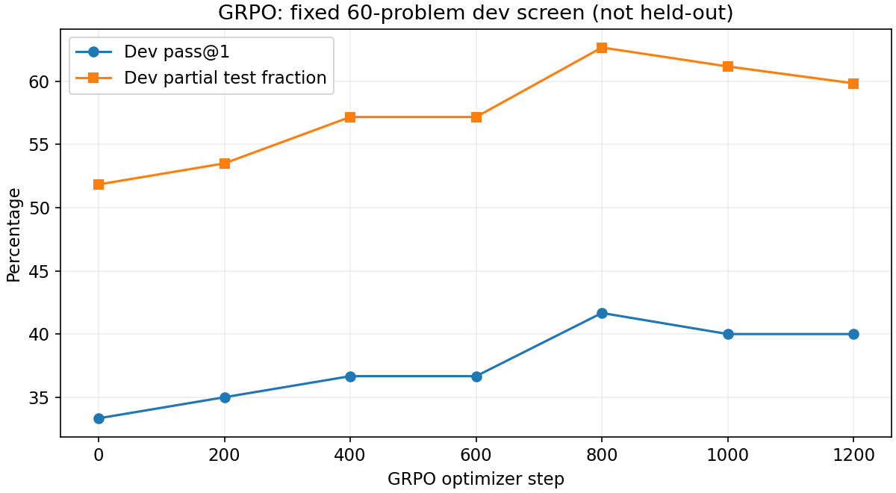

# RepairRL: practical post-training for Python program repair

**Evidence snapshot: 2026-11-11.** Main results are completed, matched V1 evaluations. GRPO step 800 is an interim checkpoint chosen using dev, not a final claim about the ongoing run. Step 1200 evaluation and later training are excluded from the completed-results table until finished. All numerical artifacts supporting the main table are exported in [report/results.json](report/results.json), with source-file checksums. This report supersedes the original proposal as a description of what actually ran.

## 1. Context, motivation and scope

RepairRL studies how a small code model changes when post-trained with three learning signals: demonstrations, preferences, and execution rewards. The practical problem is Python program repair: given a problem specification and an incorrect program, generate a complete corrected program. An external trusted grader executes tests. An optional inference agent can try again after a compact failure observation.

The practical research questions are:

1. Can a small instruction-tuned model improve through a small, verified SFT dataset?
2. Do preferences over correct and incorrect programs add value beyond SFT?
3. Does execution-reward GRPO improve held-out repair, and does any improvement transfer to another benchmark?
4. Do three feedback-guided attempts add useful success beyond a single attempt?

The project concerns standalone competitive-programming solutions and benchmark functions. It is not repository-level repair: no multi-file editing, dependencies, issue-to-commit workflow or SWE-bench result. Programs are replaced in full; patch application is not part of the benchmark. The model emits code, not explicit reasoning traces. Output quality is established by selected tests, not equivalence to gold source text.

### Pretraining, upstream instruction tuning and our specialization

The untouched `Qwen/Qwen2.5-Coder-1.5B` is the pretrained comparator (PT-base). The official card identifies its training stage as pretraining. The separately released `Qwen/Qwen2.5-Coder-1.5B-Instruct` is M0. Our SFT further specializes that already instruction-tuned checkpoint; it does not recreate Qwen's upstream post-training.

Pretrained comparator revision: `df3ce67c0e24480f20468b6ef2894622d69eb73b`.
M0 revision: `2e1fd397ee46e1388853d2af2c993145b0f1098a`.

The pretrained model is evaluated under the same chat/repair interface, including output parsing. Consequently, its score reflects both repair ability and ability to follow that interface. Its low HumanEvalPack score does not by itself quantify its general coding ability.



DPO and GRPO are **sibling branches rooted at M1**. We do not train M0→SFT→DPO→GRPO as one chain. The agent adds inference-time calls and never updates weights.

## 2. Data sources and acquisition

### RunBugRun v2

Source: [official repository and releases](https://github.com/giganticode/run_bug_run).

The acquired database contains 716,944 bug/fix records and 329,379 test records across nine languages. This is the source collection, not our training size. It originated in competitive-programming submissions and contains full source programs, problem descriptions, tests and bug metadata. Python is language enum 5 in the downloaded release; predefined split enums are 0/1/2.

The v2 release was distributed as an lrzip-compressed SQL dump. The locally preserved compressed archive is 120,501,798 bytes; the restored database is 2,298,048,512 bytes. The compressed archive SHA256 is`c46225277296add83a862e47c0bc0fb18c5d26ef8b6980bd41e5ef737f93896c`. The authoritative archive digest is recorded in the acquisition/preservation manifests; the actual database SHA256 used in extraction is`1254fcf898a84edc5264f0d57d04b2dce853bc3876805a4c370d9c254202ccf4`.

Use the manifests rather than retyping long hashes from slides. Raw programs/test cases and local data snapshots are not committed to the presentation repository. Public availability is not assumed to grant redistribution of the whole dataset.

Relevant code: `scripts/fetch_runbugrun.py`, `scripts/restore_db.py`, `data/extract_runbugrun.py`.

### HumanEvalPack Python

Source: [bigcode/humanevalpack](https://huggingface.co/datasets/bigcode/humanevalpack), Python configuration, 164 tasks. Each task provides a function declaration/specification, buggy implementation, reference implementation and tests. It is **evaluation-only**: no SFT targets, preference construction, GRPO rewards or hyperparameter selection use these examples.

Recorded dataset revision: `9a41762f73a8cb23bb5811b73d5aab164efcf378`. Prepared JSONL SHA256:`fe11a0994c92e295fbfa65bafc60deea66b43ddca3a91bc6c891d13f19b66cc7`. Initial sanity checks passed gold on 164/164 tasks and found failures for all 164 buggy programs.

### How the benchmarks differ

| Property | RunBugRun | HumanEvalPack Python |
|---|---|---|
| Program interface | Full stdin/stdout program | Function with a specified signature |
| Bug source | Incorrect human contest submissions | Benchmark buggy function implementations |
| Typical repair concerns | Input parsing, output format, control flow, arithmetic, algorithm logic | Function semantics, edge cases, return values |
| Execution | Feed stdin, compare stdout | Invoke candidate functions through isolated RPC and trusted assertions |
| Role here | Training, dev, held-out evaluation | External evaluation only |
| Final evaluated size |200 examples /144 problem groups |164 tasks |

RunBugRun test evaluates generalization within the training domain to disjoint problem groups. HumanEvalPack evaluates transfer to another format/distribution. It is not automatically harder or contamination-free: its public tasks may have been included in foundation-model pretraining.

## 3. Exact preparation and split construction

### Extraction

`data/extract_runbugrun.py` opens SQLite read-only and joins `bugs` to `problems`. It selects active Python rows, nonidentical buggy/fixed code, source token_count<=512, available descriptions and sufficient active tests. It considers all predefined source splits, then constructs our own problem-grouped splits. Candidate ordering interleaves problem groups using a per-problem sample rank.

Each task uses 2–10 active tests, selected deterministically by test ID. This cap makes execution affordable but limits test strength. The test input/output bytes are retained exactly in private trusted suites; output matching follows the repository's RunBugRun-style normalization and per-problem floating-point tolerance.

### Context and description filters

From 4,000 extracted candidates, 3,913 survive context/description filtering:

| Exclusion | Count |
|---|---:|
| Prompt overlength |50|
| Description requiring language/completeness review |32|
| Response overlength |5|

The description heuristic uses English cue words and at least 40 whitespace words. It is a heuristic, not proof that every statement is complete or fluent English. Qwen's pinned tokenizer is used to measure prompt/response length. Source token_count and Qwen token counts are different quantities. Context limits are 2,048 total tokens and 1,536 prompt tokens for this prepared pool.

### Execution verification and deduplication

Each remaining source record is checked with the same runner used for candidate evaluation:

- Fixed program must pass all selected tests.
- Buggy program must fail at least one selected test.
- Exact duplicates are detected using normalized Python AST hashes.
- Near duplicates are detected using Python-token5-gram Jaccard similarity>=0.9, considering both buggy and fixed variants.

Outcomes among 3,913 candidates:

| Outcome | Count |
|---|---:|
| Accepted |3,044|
| Gold failed selected tests |243|
| Bug passed selected tests |564|
| Exact duplicate code |55|
| Near duplicate code |7|

A source dataset's accepted fix need not execute successfully under our chosen Python/runtime/test subset. That is why verification is a preparation gate rather than an assumption.

### Grouped splits

The raw predefined splits have 226 overlapping Python problem groups, so we did not treat them as sufficient leakage protection. Our splitting uses seed 42 and groups by `problem_id`, preserving existing pilot assignments, then caps each split:

| Split | Examples | Distinct problem IDs | Use |
|---|---:|---:|---|
| Train |2,000|1,219|All training arms draw from this pool|
| Dev |200|147|Configuration/checkpoint decisions|
| Held-out RunBugRun |200|144|Final repair evaluation|
| Accepted but unused |644|Not a reported split|Not added to training|

Problem IDs are disjoint across train/dev/test. The fixed dev/test manifests remain unchanged. Frequent round2 screens use 60 distinct dev problems, selected deterministically using seed 777. They are not the 200-example held-out set.

Exact/near code-overlap auditing against HumanEvalPack found no matches under the implemented check. Semantic overlap and foundation-model pretraining contamination remain unresolved.

Authoritative prepared files: `data/prepared/scale-verified/{train,dev,test}.jsonl`, `tests.json`, `gate.json`. `training/common.check_data` checks verification gates, dataset hashes and problem-group disjointness before training.

### Data budgets and cancelled expansion

The 2,000-example budget was chosen for the original less-than40-hour, single3060 project, not because the source contains only 2,000 usable examples. A subsequent10k expansion was cancelled before training. It preserved 2,103 accepted rows at cancellation, including the original 2,000; no10k model result exists. A small CPU benchmark investigated parallel verification, but it is not evidence that10k preparation completed.

## 4. Prompt contract and model output

System prompt in `repairrl/common.py`:

```text
You are a Python code repair assistant. Return ONLY the full corrected Python 3 program.
```

User content supplies the specification and buggy code, then asks for corrected code without explanation. Qwen's tokenizer chat template formats messages. SFT masks prompt tokens; only target response tokens contribute to loss.

The parser accepts a complete program or a single clean Python Markdown fence. It rejects empty, oversized, malformed or syntactically invalid responses. It does not extract arbitrary code from a long explanation. This makes interface compliance part of measured success, especially for the pretrained comparator.

On V1 retries, the current candidate replaces the original buggy code. The only execution feedback is a sanitized summary such as `3/10 tests passed. Result: incorrect_output.` Candidate-visible scoring inputs, expected outputs and hidden assertion source are not supplied. Published examples already present in the problem description are distinct from hidden scoring tests.

## 5. Training schemes and actual settings

### Common parameter-efficient approach

Qwen2.5-Coder-1.5B-Instruct is the starting model. LoRA targets attention q/k/v/o projections and MLP gate/up/down projections. Rank 16, alpha 32 and configured dropout 0.05 produce 18,464,768 trainable parameters. SFT uses NF4 four-bit loading; the expanded DPO-hard and GRPO-long trials use FP16 model loading with LoRA. Those are different memory strategies, not full-parameter fine-tuning.

Local: RTX3060 12GB. Remote:2× RTX 5070, each about 12 GB. Torch 2.8.0+cu128, Transformers 4.56.2, TRL 0.23.1, PEFT 0.17.1, bitsandbytes 0.47.0. Local training Python 3.11 and remote training Python 3.12 are distinct from candidate Python 3.14.4.

### M1: supervised fine-tuning

Input is the frozen repair prompt; target is the same record's fixed program. No gold source is included in the input prompt.

| Setting | Actual value |
|---|---|
| Training pairs |2,000|
| Epochs / optimizer updates |1 /250|
| Learning rate |1e-4|
| Microbatch / accumulation |1 /8|
| Sequence limit |2,048|
| Quantization |NF4 QLoRA|
| Loss |Completion-only cross entropy|
| Time |1,560.8sec, about 26 min on local 3060|
| Peak allocated GPU memory |6.46GB|
| Mean training loss |0.06527|

High token accuracy is not repair accuracy. Most tokens in a fixed program may be identical to the buggy program. Copying most tokens correctly can produce excellent token metrics while leaving the actual bug unfixed.

Relevant code: `training/train_sft.py`, `training/common.py`, `configs/full-sft.yaml`.

### M2: original weak-negative DPO

The initial baseline used 1,000 existing training rows: chosen=fixed code, rejected=original buggy code. This teaches a preference against preserving the input bug, but does not compare gold against plausible generated repairs. It ran one epoch / 125 updates with lr 5e-6 and beta 0.1, rooted at a separate M1 merge. Historical results appear in the appendix under the older evaluation protocol.

### M2-hard: verified M1-generated negatives

A shuffled training subset of 1,000 source records generated four repairs per prompt: one greedy, three sampled with temperature 0.8, top-p 0.95, top-k 50 and repetition penalty 1.1. Generation used FP16 M1, up to 768 completion tokens, batched across eight prompts when memory allowed.

Collection stopped at exactly 1,000 source records per user request. Five completed source rows of batch overshoot were preserved outside the frozen training bank.

Eligible rejected responses must parse, exit normally, produce incorrect output, differ structurally from buggy/gold programs, and avoid duplicate candidate ASTs. Gold is reverified for eligible preference construction. Both responses must fit the2,048-token DPO limit. Chosen is always the source gold program; a generated successful response is not substituted as chosen.

The frozen bank contains:

- 1,062 preference pairs.
- 574 source bug records supplying negatives.
- 503 distinct problem IDs.
- 567 negatives pass at least one test; 289 pass at least half.
- Mean rejected test fraction: 25.1%.

Thus, **not every verified negative is genuinely hard**: 495 pass no selected tests despite normal execution. All eligible negatives were retained rather than keeping only the highest-scoring wrong repair. Multiple negatives from the same prompt increase pair count without increasing problem diversity. This is a limitation of the preference data, not hidden by the label DPO-hard.

| Setting | First executed configuration |
|---|---|
| Parent |Fresh M1 merge + new LoRA|
| Training preferences |1,062|
| Model loading |FP16|
| Learning rate / beta |3e-6 /0.1|
| Microbatch / accumulation |1 /8|
| Planned epochs / updates |3 /399|
| Latest preserved optimizer checkpoint |396|
| Response length handling |Reject overlength pairs; no truncation|
| Reference |Frozen M1; cached reference log probabilities|
| Save/dev screen |Every 66 updates, fixed 60-problem dev|
| Selected snapshot |Step 66,21/60 dev pass@1|

The user stopped the queue and cancelled the higher-lr and RPO variants. The selected step 66 adapter is inference-only; later complete Trainer checkpoints contain resumable optimizer/scheduler/RNG states. Selection used the existing 60-task dev screen; the originally planned top-three 147-problem reranking was skipped and disclosed.

Dev pass counts: step 0=20/60; 66=21/60; 132=21/60; 198=20/60; 264=20/60; 330=19/60. Preference training improves while later dev repair declines. This supports investigating overfitting/objective mismatch, but does not identify a causal mechanism or establish catastrophic forgetting.

Relevant code: `scripts/round2_fast_rollouts.py`, `scripts/round2_rollouts.py`, `scripts/round2_train.py`, `scripts/train_dpo_cached.py`, `scripts/round2_eval_selected_dpo.py`.

### M3: original short GRPO

The original experiment used 200 updates with four sampled programs per prompt and 512 completion tokens, after a variance gate and short trainer pilot. It loaded the M1 parent in NF4. Reward was zero for invalid/fatal execution, otherwise test fraction plus a small all-pass bonus. A 57% zero-variance group rate during the 200-step run limited the useful relative learning signal. It is retained as a separate historical experiment.

### M3-long: execution-reward GRPO

This branch independently starts from the same M1 parent as DPO-hard. It uses 2,000 prompt rows; trusted tests remain in the grader. Four current-policy completions are sampled per prompt and scored by execution. Reward differences within a sampled group provide the relative learning signal.

Dense reward:

```text
R = 0.85 × passed_test_fraction
  + 0.10 × normal_exit_fraction
  + 0.05 × all_tests_pass
```

Invalid programs receive 0. Normal-exit fraction counts passed and wrong-output tests as clean executions. Partial credit survives when another test has a runtime error/timeout. All-pass reward is 1; any genuinely failing program scores below 1. The clean-exit term helps distinguish noncrashing wrong programs from crashes, but is also a possible incentive mismatch to monitor.

| Setting | Current long-run configuration |
|---|---|
| Training prompts |2,000|
| Parent/loading |Fresh M1 merge, FP16 LoRA|
| Maximum optimizer updates |2,000|
| Generations per prompt |4|
| Microbatch / accumulation |1 /4|
| Learning rate / beta |5e-6 /0.04|
| Sampling |Temperature0.8, top-p 0.95, top-k 50, repetition penalty 1.1|
| Prompt / completion limits |1,536 /768|
| TRL loss |`dapo` token-normalized GRPO variant|
| Warmup |3%|
| Save and dev screen |Every 200 updates, same 60 dev problems|
| Early stop |At least 800 updates; 600 updates without a better dev score|

The variance probe found 20/30 groups with mixed rewards, meeting the gate. Save completion does not establish learning: dev execution success determines snapshot quality. The step 800 checkpoint was selected by dev, then evaluated on held-out tasks. Later checkpoints are not substituted into the step 800 result.

All model outputs are code. We did not train explicit chain-of-thought targets or claim to observe an internal reasoning process. Outcome-reward RL is well suited to this verifiable task, but the experiment does not prove GRPO universally superior to DPO.

Relevant code: `evaluation/reward_v2.py`, `scripts/round2_train.py`. The exact source loaded by the original long-run process is additionally preserved at `docs/seminar/sources/round2_train_executed_grpo.py`; later on-disk edits must not be mistaken for executed source.

## 6. Agent and trusted execution

V1 performs at most three sequential code generations. It grades attempt 1; if unsuccessful, it supplies the current candidate and sanitized failed-test summary; it stops early on success. This is inference-only feedback-guided repair, not three independent samples. V1 does not contain a separate diagnosis call or robust duplicate-patch avoidance. Weak agent gains can reflect repeated candidates and limited feedback as well as model limitations.

A V3.1 diagnosis/repair controller was implemented and evaluated, but it did not consistently improve dev/held-out outcomes. The user removed it from future queues. Historical V3 results remain; all main report results use V1.

Original runner: Bubblewrap, UID65534, no network, bounded CPU/RAM/processes/output, read-only runtime and no candidate access to trusted test files. Timeout 3seconds per test, memory 512MB, output cap 65,536bytes.

RunBugRun executes `python candidate.py` with trusted test input on stdin. HumanEvalPack keeps assertions in the trusted grader; each function call is executed in an isolated JSON-RPC wrapper with arguments only. Expected outputs and assertion code are not candidate-visible.

The original remote jobs used a local grader over a reverse SSH tunnel because the server blocked Bubblewrap user namespaces. This dependency was subsequently removed: grading now runs entirely on the server using chroot/seccomp and the copied Python 3.14.4 interpreter/runtime. Gold-pass/bug-fail sanity passed on 20 RunBugRun and all 164 HumanEvalPack tasks. Runtime/backend changes are recorded in `results/round2/grader-migration.json`. Step 1200 evaluation crosses backends and is disclosed separately. The main completed table below predates that migration.

## 7. Metrics and evaluation controls

Current main protocol:

- V1 controller, greedy decoding, seed 42.
- FP16 inference for all models, context 4,096, max 768 generated code tokens per attempt.
- Same benchmark manifests, task order, parser, grader and attempt budget.
- RunBugRun 200 tasks; HumanEvalPack 164.
- M1 baseline uses the exact merged parent copied from the remote experiment. An earlier local M1 merge produced slightly different numerical weights; those historical results are not silently substituted.

`pass@1` is the fraction of tasks passing every selected test on attempt 1. `agent@3` is the fraction solved within at most three feedback-guided attempts. It is not ordinary independent-sample pass@3.

For partial tests, report a per-task mean at attempt 1 and optionally the best-tested candidate within three attempts. Do not confuse these with the existing summary field `partial_fraction`: that field averages over **all generated attempts**, so models making different numbers of failed retries get different weighting. HumanEvalPack's adapter records task-level binary success (`Grade(..., total=1)`), not a fraction of individual assertions.

Validity measures parseability, not execution correctness. Latency/token usage are useful diagnostics, but local 3060 versus remote5070 timing is not a matched hardware comparison.

## 8. Completed V1 held-out results



| Checkpoint | RunBugRun pass@1 | RunBugRun agent@3 | HumanEvalPack pass@1 | HumanEvalPack agent@3 |
|---|---:|---:|---:|---:|
| PT-base |54/200 =27.0%|57/200 =28.5%|19/164 =11.6%|19/164 =11.6%|
| M0 Instruct |58/200 =29.0%|60/200 =30.0%|94/164 =57.3%|106/164 =64.6%|
| M1 SFT |68/200 =34.0%|80/200 =40.0%|101/164 =61.6%|108/164 =65.9%|
| M2-hard step 66 |67/200 =33.5%|76/200 =38.0%|94/164 =57.3%|104/164 =63.4%|
| M3-long step 800 |76/200 =38.0%|85/200 =42.5%|99/164 =60.4%|108/164 =65.9%|

These are completed evaluations, not selected prefixes. All full RunBugRun problems in this table are held out from training by problem ID. HumanEvalPack is never training data. Checkpoint selection uses dev; curated demonstrations below use observed held-out outcomes and must be labelled as such.

### Test fraction on RunBugRun

| Per-task diagnostic | M1 | GRPO step 800 |
|---|---:|---:|
| First-attempt test fraction |56.1%|60.3%|
| Best-tested fraction within3 |61.0%|64.2%|

The best-tested diagnostic is retrospective: it is not a claim that V1 selects/returns the best candidate on failed tasks. V1's reported final candidate is its latest candidate.

### Paired changes and uncertainty

Against M1, GRPO step 800 has 8 pass@1 wins and 0 losses on RunBugRun. Agent@3 has 6 wins and 1 loss. HumanEvalPack pass@1 has 2 wins and 4 losses; agent@3 has 3 wins and 3 losses.

A 2,000-draw paired bootstrap, clustering RunBugRun by 144 problem IDs and HumanEvalPack by 164 task IDs, gives:

| GRPO versus M1 | Change | Approximate95% interval |
|---|---:|---:|
| RunBugRun pass@1 |+4.0pp|+1.5 to+7.2pp|
| RunBugRun agent@3 |+2.5pp|0.0 to+5.2pp|
| HumanEvalPack pass@1 |−1.2pp|−4.3 to+1.8pp|
| HumanEvalPack agent@3 |0.0pp|−3.0 to+3.0pp|

These intervals describe evaluation-sample uncertainty for the evaluated checkpoints. They do not cover training-seed variation, all selection/adaptive experiment choices, test-suite weakness or pretraining contamination. They do not establish a universal algorithm ranking.

### Dev progression is a separate table



| GRPO step | Dev pass@1 | Dev test fraction |
|---:|---:|---:|
|0, M1 parent|20/60 =33.3%|51.8%|
|200|21/60 =35.0%|53.5%|
|400|22/60 =36.7%|57.2%|
|600|22/60 =36.7%|57.2%|
|800|25/60 =41.7%|62.7%|
|1000|24/60 =40.0%|61.2%|
|1200|24/60 =40.0%|59.8%|

This report snapshot includes completed dev evaluations through 1200. Later dev results may exist after publication. The800→1200 decline suggests plateau/regression worth monitoring; it does not establish catastrophic forgetting. Step 1200 held-out evaluation was explicitly requested despite a worse dev score; it is exploratory and must not tune continuing training.

## 9. Three curated case studies

All cases are selected using observed results for illustration, not sampled to estimate model quality. Source IDs and public outcome metadata are in [report/case-studies.json](report/case-studies.json). Full owner-only replay data, without hidden tests, is available separately from the public repository. Raw benchmark programs/test suites are not bundled publicly. No demo input/output below comes from hidden scoring cases.

Status cells below are **first attempt / within3**.

| Case | PT-base | M0 | M1 | DPO-hard66 | GRPO800 |
|---|---|---|---|---|---|
|Cup swap, RunBugRun 21346|Fail/Fail|Fail/Fail|Fail/Fail|Pass/Pass|Pass/Pass|
|Debug output, RunBugRun 186967|Fail/Fail|Fail/Fail|Pass/Pass|Fail/Fail|Pass/Pass|
|Largest divisor, Python/24|Fail/Fail|Pass/Pass|Pass/Pass|Fail/Pass|Pass/Pass|

### Case1 — most convincing live explanation: cup swap

RunBugRun ID 21346, problem p00047. Track which cup holds a ball while pairs of cups are swapped. The original program uses two independent conditionals. After the first changes the location, the second can fire and immediately undo that change. The repair makes the branches mutually exclusive (`if … elif …`). For a slide, this is the relevant logic (variable names simplified):

```python
if x == ball:
    ball = y
elif y == ball:
    ball = x
```

PT-base preserved the bug and passed 2/3 selected tests. M0 introduced an unsupported leading-count input assumption and failed at runtime. M1 changed equality tests to inequalities and passed 1/3. Both DPO and GRPO generated the mutually exclusive-branch repair and passed 3/3 on attempt 1.

This is a compact control-flow explanation with an intuitive state transition. It shows a real DPO success as well as a GRPO success; DPO's lower aggregate score does not mean every task worsens. Use this as the primary demonstration because its mechanism is easy to explain without revealing hidden test data.

### Case2 — SFT success, DPO regression, GRPO preservation

RunBugRun ID 186967, problem p02588. The program counts pairs of decimal numbers whose product is an integer. The original program prints an internal counting dictionary before the required answer. Even correct arithmetic produces wrong stdout.

PT-base and M0 kept that debug print; M1 removed it and passed. DPO reintroduced/retained the debug print and failed. GRPO removed it and passed. Attempt1 test fractions are0%, 0%, 100%, 0%, 100% respectively.

The observable mechanism is unnecessary stdout, not proof that one model acquired deeper numerical reasoning. It is a useful example of execution-sensitive behavior and a specific behavioral regression after preference training.

### Case3 — interface compliance and a recoverable DPO regression

HumanEvalPack Python/24, `largest_divisor`. The task asks for the largest proper divisor. M0, M1 and GRPO produce a descending divisor search using modulo. PT-base's output mixes duplicate implementations/fences and extra format tokens, so the strict parser rejects it even though part of the text contains a plausible repair.

DPO's first candidate uses subtraction rather than a divisibility test and fails. Its inference agent later repairs the function, so DPO's cell is **Fail/Pass**, not Fail/Fail. This illustrates why reporting pass@1 and agent@3 separately matters. It also demonstrates why the pretrained comparison includes output-format compliance.

## 10. Interpretation: evidence versus hypotheses

### Supported by this experiment

- Repair SFT improves the matched main protocol on both benchmarks relative to M0.
- This selected DPO-hard checkpoint underperforms M1 on both benchmarks.
- GRPO step 800 improves RunBugRun first-attempt and agent repair, with no demonstrated HumanEvalPack transfer gain.
- Inference feedback adds successes, but gains depend on the model/task and V1 can repeat failed behavior.
- Later GRPO and DPO checkpoints need not improve monotonically.

### Plausible explanations, not demonstrated causes

**Preference/execution mismatch:** DPO optimizes relative sequence likelihood for fixed pairs, while evaluation requires execution success on new tasks. Improving preference accuracy can coexist with lower repair success. Pair construction, zero-pass negatives, repeated problems, reference strength, learning rate and duration are all confounded here. Correct preference labels alone do not ensure a useful objective for generalization.

**Domain specialization:** RunBugRun execution training can favor that distribution without transferring to function-style HumanEvalPack. This is consistent with the observed pattern, but two fewer first-attempt HumanEvalPack solves are not proof of harmful drift.

**Catastrophic forgetting:** Not established. We did not evaluate a broad pre/post capability suite or isolate forgetting from ordinary variance/specialization. LoRA leaves base weights frozen but can still change behavior; frozen base weights do not rule out behavioral regression.

**GRPO for reasoning:** On-policy sampling with verifiable outcome rewards is attractive for code/math. This project studies program outcomes, not observed reasoning traces, and tests only a small set of configurations. It does not prove that reasoning requires GRPO or that DPO intrinsically fails on code.

## 11. Connection to ReCode

[ReCode, ACL2026](https://aclanthology.org/2026.acl-long.2031/) is the research connection for using execution-aware signals in repair post-training. Its contribution includes a learned reasoning-process reward and correctness-gated use of that signal.

RepairRL implements an outcome reward from tests. It does **not** implement the paper's learned RPR scorer, contrastive reasoning preference learning, or full consistency-gated GRPO method. Our separate diagnosis agent is not a learned process-reward model. The relationship is conceptual inspiration, not reproduction. See the [ReCode connection](06_RECODE_CONNECTION.md) for the paper-specific details and limitations.

## 12. Threats to validity and technical lessons

- One main training seed; no multi-seed learning comparison.
- Limited training budget:2k pairs and 1,219 training problem groups.
- Only2–10 RunBugRun tests per task; passing selected suites does not prove general correctness.
- Different example counts versus problem counts; clustering matters for uncertainty.
- Imperfect statement/language and semantic-overlap filters.
- Public benchmark pretraining contamination is unresolved.
- Pretrained chat-format compliance confounds a pure capability interpretation.
- DPO preference count overstates independent problem diversity; almost half the negatives pass zero tests.
- Parent merge/quantization can alter outputs; exact parent identity must be tracked.
- Hardware and execution backend changes limit timing comparisons.
- Repeated interim held-out inspection raises the risk of adaptive test selection. Continuing model selection must stay on dev, and interim analyses must be disclosed.
- Training completion, low loss or high token/preference accuracy are not substitutes for test-based evaluation.
- Server/laptop dependency became an operational failure point; a self-contained remote grader removed it.

## 13. Reproducibility and continuation

Use `requirements.lock`, experiment JSON, frozen prompt/protocol files, dataset hashes, parent merge manifests, original logs and source hashes. Preserve both inference adapters and full Trainer checkpoints. The latter require optimizer, scheduler, RNG, scaler and trainer state; an adapter alone cannot resume the same optimizer trajectory.

Main code map:

| Stage | Implementation |
|---|---|
|Acquire/extract|`scripts/fetch_runbugrun.py`, `data/extract_runbugrun.py`|
|Verify/deduplicate/split|`data/filter_and_split.py`|
|Prompt/model loading|`repairrl/common.py`, `repairrl/model.py`|
|SFT|`training/train_sft.py`, `training/common.py`|
|Hard preference generation|`scripts/round2_fast_rollouts.py`, `scripts/round2_rollouts.py`|
|DPO/GRPO optimization|`scripts/round2_train.py`, `scripts/train_dpo_cached.py`|
|Execution reward|`evaluation/reward_v2.py`|
|V1 agent|`agent/repair.py`|
|Output parsing/matching|`evaluation/runner.py`|
|HumanEvalPack adaptation|`evaluation/humanevalpack_adapter.py`|
|Frozen round2 evaluator|`evaluation/round2.py`|
|Original/server execution|`agent/sandbox.py`, `agent/server_sandbox.py`|
|Matched comparison/bootstrap|`scripts/round2_report.py`|
|Report data/figures|`scripts/build_report_assets.py`|

Generate the report figures using the preserved private experiment outputs and the isolated figure environment described in `requirements-figures.lock`. The checked-in exported JSON/PNG/SVG is sufficient to read the measured comparison without downloading model weights. Regeneration requires access to the original trace files at their recorded paths; they are not publicly bundled.

## Appendix A. Original completed V1 experiment, different protocol

These are NF4 inference results with 512 completion tokens. Do not mix them numerically with the FP16/768-token main table above.

| Model | RunBugRun pass@1 / agent@3 | HumanEvalPack pass@1 / agent@3 |
|---|---|---|
|M0|29.0% /32.0%|55.5% /62.2%|
|M1|33.0% /39.0%|53.7% /63.4%|
|M2 weak DPO|29.5% /34.5%|53.0% /67.1%|
|M3 short GRPO|32.5% /37.0%|53.0% /61.6%|

The original M1 root/quantization setup and the later exact merged-parent baseline are different evaluation realizations, not contradictory measurements of one identical protocol.

## Appendix B. Suggested seminar emphasis

Spend more time on verification, preference construction, execution rewards, matched evaluation and failure interpretation than on textbook derivations. Show the cup-swap case first, then the debug-print regression and pretrained formatting case. Show both benchmarks before interpreting an algorithm. Explain why the DPO finding is useful even though it is negative, why GRPO's in-domain gain is narrower than broad reasoning improvement, and why checkpoint/adapter provenance and resumability matter in practical work.
